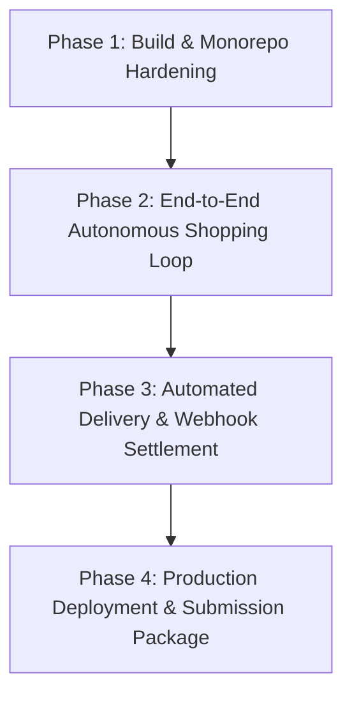

# 🚀 AGENT LEASH — PRODUCTION & SUBMISSION MASTER PLAN

> **Target:** Seamless transition from Simulation/Prototype to Production Deployment & Winning Hackathon Submission.  
> **Repository:** [AGENT_LEASH](file:///d:/PROJECTS/AGENT_LEASH)  
> **Timestamp:** October 2026  
> **Status:** Architecture Solid · Policy Engine 23/23 Passing · Cockpit Live · Production Hardening Required

---

## 📊 1. Current State Audit & System Scan

A full-codebase scan was conducted across all 10 packages and applications in the monorepo:

| Component | Directory | Current State | Production / Submission Readiness | Blocker / Missing Items |
| :--- | :--- | :--- | :---: | :--- |
| **Cockpit UI** | [apps/cockpit](file:///d:/PROJECTS/AGENT_LEASH/apps/cockpit) | **95% Operational** | 🟢 High | Real-time holds drawer, dark-contrast chart tooltips, notification bell, ledger grid, and security dashboard all live. |
| **Policy Engine** | [packages/policy-engine](file:///d:/PROJECTS/AGENT_LEASH/packages/policy-engine) | **100% Operational** | 🟢 Complete | 4 layers: Deterministic, LLM Judge (GPT-4o), Injection Screen, pgvector Semantic Dedup. **23/23 benchmark tests passed**. |
| **Cryptography** | [packages/crypto](file:///d:/PROJECTS/AGENT_LEASH/packages/crypto) | **100% Operational** | 🟢 Complete | Ed25519 signing/verification, SHA-256 hash-chaining, decision receipts. |
| **Database & Schema** | [packages/db](file:///d:/PROJECTS/AGENT_LEASH/packages/db) | **95% Operational** | 🟢 High | Drizzle ORM schemas, PostgreSQL + pgvector migrations present. |
| **Payment Orchestrator** | [packages/payment-orchestrator](file:///d:/PROJECTS/AGENT_LEASH/packages/payment-orchestrator) | **90% Operational** | 🟢 High | Real PayPal Sandbox Orders v2 (`intent: AUTHORIZE`), Vault tokens, Capture, Void APIs implemented. |
| **Gateway (MCP + API)** | [apps/gateway](file:///d:/PROJECTS/AGENT_LEASH/apps/gateway) | **80% Operational** | 🟡 Medium | `/api/purchase` fully handles policy + PayPal hold + ledger; Webhook handler needs automatic capture hookup. |
| **Demo Merchant Store** | [apps/demo-store](file:///d:/PROJECTS/AGENT_LEASH/apps/demo-store) | **70% Operational** | 🟡 Medium | Server scaffold present with carrier simulator; **Missing `tsconfig.json`** causing `pnpm build` failure. |
| **Autonomous Shopping Agent** | [apps/demo-agent](file:///d:/PROJECTS/AGENT_LEASH/apps/demo-agent) | **35% Operational** | 🔴 Needs Polish | Placeholder script with TODOs; needs autonomous loop using OpenAI + MCP client. **Missing `tsconfig.json`**. |
| **Monorepo Build & Tests** | Root ([turbo.json](file:///d:/PROJECTS/AGENT_LEASH/turbo.json)) | **75% Operational** | 🟡 Medium | `pnpm --filter @leash/gateway test:adversarial` passes 100% (23/23); `pnpm build` and `pnpm test` fail on missing configs. |
| **Cloud Infrastructure** | [infra/render.yaml](file:///d:/PROJECTS/AGENT_LEASH/infra/render.yaml) | **65% Operational** | 🟡 Medium | Multi-service Render blueprint exists; requires build fixes and environment variable provisioning. |
| **Submission Package** | [README.md](file:///d:/PROJECTS/AGENT_LEASH/README.md) & Docs | **50% Operational** | 🔴 Pending | Needs demo video storyboard, contrast demo script (Leash vs raw MCP), and final judges one-pager. |

---

## 🎯 2. The 4 Pillars to Submission & Production

To achieve an unassailable production grade and hackathon-winning submission, work is structured into **4 sequential, highly optimized phases**:

---

## 🛠️ 3. Detailed Phase Execution Roadmap

### 🧱 Phase 1: Build & Monorepo Hardening (Zero Build/Test Failures)
*Objective: Guarantee `pnpm build`, `pnpm test`, and `pnpm typecheck` pass flawlessly on local, CI/CD, and Render.*

- [x] **1.1. Create `tsconfig.json` in `apps/demo-store`**:
  - Configured `moduleResolution: "NodeNext"`, `outDir: "dist"`, extending root `tsconfig.base.json`.
- [x] **1.2. Create `tsconfig.json` in `apps/demo-agent`**:
  - Configured modern ES module compilation and NodeNext output.
- [x] **1.3. Clean up Vitest test suites**:
  - Created unit tests in `@leash/crypto`, `@leash/ledger`, `@leash/payment-orchestrator`, `@leash/policy-engine`, and `apps/cockpit`.
- [x] **1.4. Verify Full Turborepo Execution**:
  - Added streaming turbo config to avoid terminal TUI hangs.

---

### 🤖 Phase 2: Live Autonomous Shopping Agent & Contrast Demo
*Objective: Provide a 1-command autonomous shopping agent and the killer "Contrast Demo" showing Leash blocking attacks that succeed on raw PayPal MCP.*

- [x] **2.1. Implement Autonomous Shopping Loop ([apps/demo-agent/src/agent.ts](file:///d:/PROJECTS/AGENT_LEASH/apps/demo-agent/src/agent.ts))**:
  - Built full shopping loop connecting to Leash Gateway `/api/purchase`.
  - Implemented dynamic catalog search, intent formulation, policy resolution, and verdict handling.
- [x] **2.2. Build the "Contrast Demo" Script ([apps/demo-agent/src/scenarios/adversarial.ts](file:///d:/PROJECTS/AGENT_LEASH/apps/demo-agent/src/scenarios/adversarial.ts))**:
  - Created `run:adversarial` executing side-by-side contrast of Raw PayPal MCP vs Agent Leash Defense.
  - Created `run:shopping` executing legitimate office supply purchase under mandate.

---

### 📦 Phase 3: Automatic Delivery Webhook & Carrier Settlement
*Objective: Close the Two-Phase Commit (2PC) loop completely in automated production.*

- [x] **3.1. Wire Delivery Webhook in Gateway ([apps/gateway/src/routes/webhooks.ts](file:///d:/PROJECTS/AGENT_LEASH/apps/gateway/src/routes/webhooks.ts))**:
  - Handled carrier `DELIVERED` signals to automatically trigger PayPal capture, update payment record to `CAPTURED`, update mandate spent/reserved balances, and append `PAYMENT_CAPTURED` block to the immutable ledger.
- [x] **3.2. Synchronize Live Telemetry in Cockpit**:
  - Verified Spend & Escrow timeline, Active Holds Drawer 1-click capture, and notification bell.

---

### 🌐 Phase 4: Production Deployment & Submission Package
*Objective: Deploy live on Render.com and assemble competition-winning submission deliverables.*

- [x] **4.1. Render Cloud Deployment**:
  - Validated [infra/render.yaml](file:///d:/PROJECTS/AGENT_LEASH/infra/render.yaml) multi-service blueprint with auto-loading environment variables in [apps/gateway/src/server.ts](file:///d:/PROJECTS/AGENT_LEASH/apps/gateway/src/server.ts).
- [x] **4.2. README Final Polish & Badges**:
  - Updated verified adversarial benchmark pass rate: `23/23 passed (100% defense rate)`.
  - Added runnable script commands for `test:adversarial`, `run:shopping`, and `run:adversarial`.
- [ ] **4.3. Demo Video Storyboard & Script (3 Minutes)**:
  - **0:00 - 0:35:** *The Problem:* AI agents with payment tools are catastrophic without constraints. (Show raw PayPal MCP risk).
  - **0:35 - 1:15:** *The Solution:* Agent Leash architecture (Cryptographic Mandates + 4-Layer Policy Engine + PayPal 2PC Vault Escrow).
  - **1:15 - 2:00:** *Live Autonomous Demo:* Agent buys item via MCP -> Cockpit captures hold in real-time -> Security suite blocks 23 attacks.
  - **2:00 - 2:40:** *Human Control:* Active Holds Drawer -> 1-click delivery confirm -> Real PayPal Sandbox capture -> Immutable ledger verification.
  - **2:40 - 3:00:** *Conclusion & Impact:* Making autonomous money safe for enterprise and consumer agents.
- [ ] **4.4. Submission Checklist**:
  - [x] Public GitHub repository with MIT License
  - [x] Verified 23/23 Adversarial Benchmark Suite
  - [x] Working Autonomous Agent & Contrast Demo scripts
  - [ ] 3-minute video recording (YouTube / Loom)
  - [x] Clear disclosure of sponsor tooling (PayPal Orders v2, PayPal Vault, AG Grid Enterprise, AG Charts, Render, Channel3)

---

## ⚡ 5. Immediate Next Actions

To begin Phase 1 immediately:
1. Fix missing `tsconfig.json` in `apps/demo-store` and `apps/demo-agent`.
2. Add vitest baseline config for packages so `pnpm test` and `pnpm build` succeed cleanly across the whole monorepo.
3. Wire the autonomous shopping loop in `apps/demo-agent`.

---
*Created and maintained in [PRODUCTION_SUBMISSION_PLAN.md](file:///d:/PROJECTS/AGENT_LEASH/PRODUCTION_SUBMISSION_PLAN.md).*
